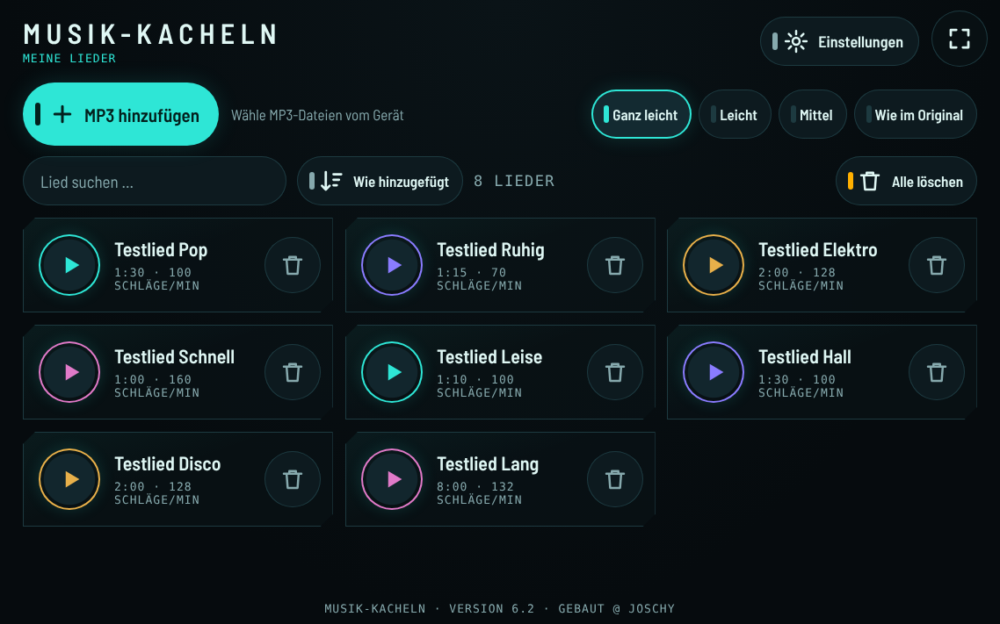
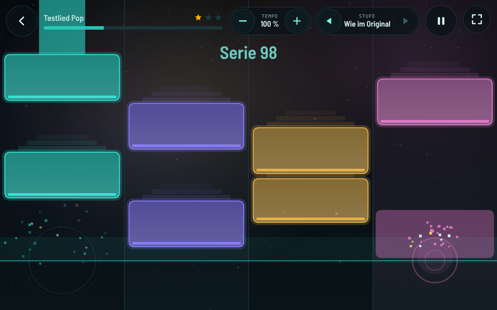
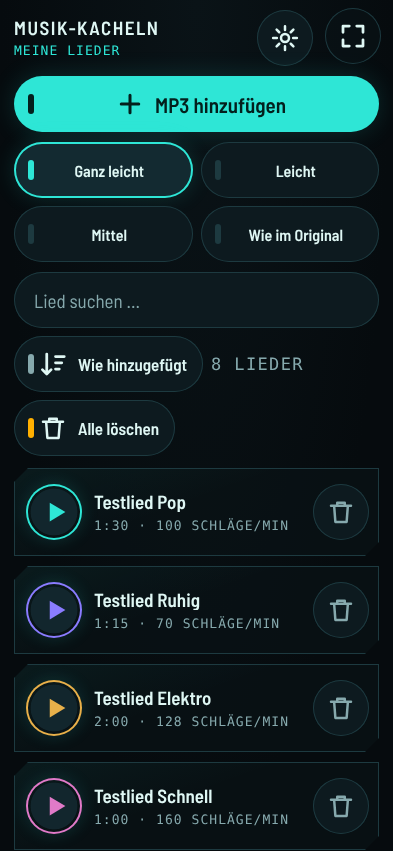
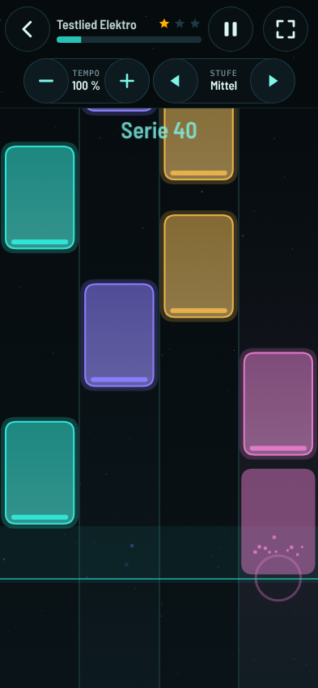
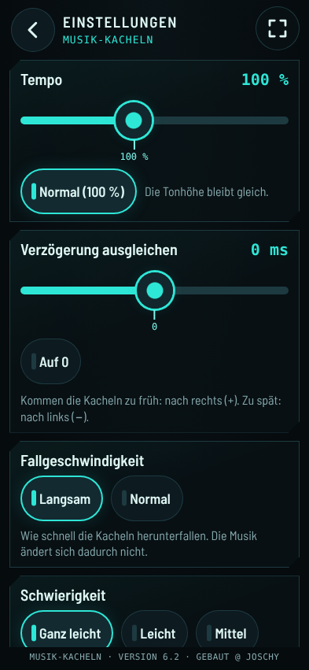
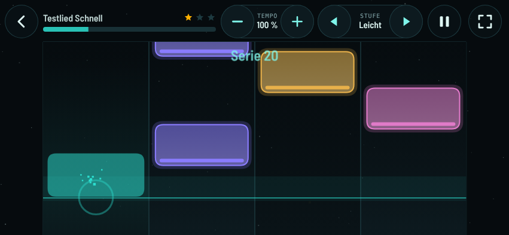

# Krishnas Spiele – Musik-Kacheln

## Download

**[APK herunterladen](https://github.com/jr-stack-bot/krishnas-spiele/releases/latest/download/krishnas-spiele.apk)** · [Release-Seite](https://github.com/jr-stack-bot/krishnas-spiele/releases/latest)

Für Android-Tablets und -Handys ab Android 8.

1. Die heruntergeladene APK öffnen.
2. Bei Nachfrage „Installation aus dieser Quelle zulassen“ erlauben.
3. Installieren – fertig. Neue Versionen lassen sich einfach drüberinstallieren.

## Was ist das?

**Musik-Kacheln** (Version 6.2) ist ein ruhiges Tipp-Spiel für Tablet und Handy: Du wählst eigene MP3-Dateien aus, die App hört sich die Musik an und macht daraus Kacheln. Die Kacheln fallen im Takt der Musik herunter. Tippe sie an, wenn sie die Linie erreichen.

Auf dem Gerät heißt die App weiterhin **„Krishnas Spiele“**.

## Neu in Version 6.2

- **Läuft auf Handys und Tablets** – die Oberfläche passt sich der Bildschirmgröße an, vom kleinen Handy bis zum großen Tablet.
- **Hoch- und Querformat** – die App folgt der Drehung des Geräts (die Drehsperre von Android wird beachtet).
- **Falt-Geräte** – Auf- und Zuklappen wird ohne Neustart übernommen.
- **Notch-Ränder** – Kamera-Aussparungen werden freigehalten, nichts Wichtiges liegt darunter.
- **Ältere Android-Versionen** – läuft ab **Android 8**, auch mit älteren WebView-Versionen.
- **Drehen im Spiel** – beim Drehen oder Falten läuft das Lied weiter, das Spielfeld wird nahtlos neu eingeteilt.
- **Zurück-Taste pausiert im Spiel** – die Zurück-Taste bzw. -Geste schließt zuerst ein offenes Fenster und hält ein laufendes Spiel nur an, statt die App zu verlassen.
- **Grenzen bei wenig Speicher** – auf Geräten mit wenig Arbeitsspeicher (etwa 2 GB) nimmt die App kürzere Lieder an (MP3 bis 12 Minuten, andere Formate bis 5 Minuten, Dateien bis 50 MB), zeichnet mit weniger Partikeln und senkt bei Bedarf die Auflösung, damit nichts abstürzt.

**Hinweis:** Echt getestet ist die App bisher nur auf dem Tablet **Samsung Galaxy Tab S5e**. Handys, Falt-Geräte und ältere Android-Versionen wurden nur im Browser nachgestellt. Rückmeldungen von anderen Geräten sind sehr willkommen!

## Neu in Version 6.1

- **Alle löschen** – ein Knopf über der Liste entfernt alle Lieder auf einmal. Vorher kommt eine Rückfrage („Wirklich alle 8 Lieder löschen?“), „Nein, behalten“ ist voreingestellt. Die Einstellungen bleiben erhalten.
- **Suche und Sortierung** – ab 8 Liedern erscheinen ein Suchfeld und ein Sortier-Knopf („Wie hinzugefügt“, „A–Z“, „Neueste zuerst“).
- **Tempo und Stufe live ändern** – oben in der Spielansicht lassen sich Tempo (−/+) und Schwierigkeit (◀/▶) während des Liedes umstellen, ohne neu zu starten.
- **Effekte: Ruhig, Normal oder Viel** (in den Einstellungen, Standard „Normal“) – Funken, Ringe, Serien-Anzeige („Super!“) und ein Feuerwerk am Lied-Ende. Mit Sicherheitsgrenzen:
  - **kein Flackern**: höchstens 3 Hell-Dunkel-Blitze pro Sekunde (Grenze nach WCAG), keine großflächigen Helligkeitswechsel;
  - feste **Obergrenze für Partikel** je Stufe;
  - **adaptive Absenkung**: wird das Tablet zu langsam (unter etwa 45 Bilder pro Sekunde), schaltet die App die Effekte automatisch eine Stufe herunter;
  - bei „Bewegung sparsam“ oder der System-Einstellung „Weniger Bewegung“ bleiben die Effekte immer auf „Ruhig“.

## Screenshots

Die Bilder zeigen die App auf dem Tablet im Querformat (1138 × 711), auf dem Handy hochkant (393 × 851) und auf dem Handy quer (851 × 393). Die Lieder darauf sind selbst erzeugte Test-Töne, keine echte Musik.

<table>
  <tr>
    <td colspan="3" align="center"> Tablet quer: Startseite mit eigenen Liedern</td>
  </tr>
  <tr>
    <td colspan="3" align="center"> Tablet quer: mitten im Lied mit Effekten „Viel“ und Serien-Anzeige</td>
  </tr>
  <tr>
    <td width="33%" align="center"> Handy hochkant: Startseite</td>
    <td width="33%" align="center"> Handy hochkant: Spiel</td>
    <td width="33%" align="center"> Handy hochkant: Einstellungen (lassen sich weiter nach unten schieben)</td>
  </tr>
  <tr>
    <td colspan="3" align="center"> Handy quer: Spiel</td>
  </tr>
</table>

## Kurzanleitung

1. **MP3 aufs Gerät kopieren** – zum Beispiel per USB-Kabel in den Ordner „Download“ oder „Music“.
2. In der App **„MP3 hinzufügen“** antippen und eine oder mehrere Dateien auswählen. Die App bereitet jedes Lied einmal vor (das dauert ein paar Sekunden). Danach steht es in der Liste.
3. Oben die **Schwierigkeit** wählen: „Ganz leicht“, „Leicht“, „Mittel“ oder „Wie im Original“.
4. Wer mag, stellt in den **Einstellungen** das **Tempo** ein (langsamer oder schneller, die Tonhöhe bleibt gleich) und wählt die **Effekte** („Ruhig“, „Normal“ oder „Viel“).
5. Beim Lied auf **Abspielen** tippen, Countdown abwarten, Kacheln an der Linie antippen. Tempo und Stufe lassen sich oben auch während des Liedes ändern.

Ein Lied löschen: auf den Mülleimer tippen und noch einmal bestätigen. Alle Lieder löschen: „Alle löschen“ über der Liste, danach die Rückfrage mit „Ja, alle löschen“ bestätigen.

Viele Lieder: Ab 8 Liedern gibt es ein Suchfeld und einen Sortier-Knopf über der Liste.

## Grenzen

- **MP3** bis **20 Minuten** Länge.
- **Andere Formate** (z. B. M4A, OGG, WAV) bis **8 Minuten**.
- Dateien bis **80 MB**.
- Auf Geräten mit **wenig Arbeitsspeicher** (etwa 2 GB): MP3 bis **12 Minuten**, andere Formate bis **5 Minuten**, Dateien bis **50 MB**. Effekte und Bildauflösung werden dort automatisch gesenkt.
- Stille oder beschädigte Dateien werden mit einer freundlichen Meldung abgelehnt.
- Der Dateidialog von Android zeigt alle Dateien an; die App übernimmt nur Musikdateien, die sie lesen kann.

## Datenschutz

- Die Musik wird **nur auf dem Gerät** verarbeitet. **Nichts wird hochgeladen**, die App braucht kein Internet.
- Die vorbereiteten Lieder werden nur auf dem Gerät gespeichert (im Speicher der App).
- Im App-Paket und in diesem Repo ist **keine Musik** enthalten.
- Jeder ist selbst dafür verantwortlich, dass er die Rechte an den eigenen Dateien hat.

## Wie entstehen die Kacheln?

Die App hört sich das Lied einmal ganz an und sucht darin:

- **Den Takt** – wie viele Schläge pro Minute das Lied hat und wo die Schläge liegen.
- **Einsätze** – Stellen, an denen ein Ton oder ein Schlag neu beginnt.
- **Die Klangfarbe** – ob ein Einsatz eher tief (z. B. Bass-Trommel) oder eher hell (z. B. Becken) klingt. Danach kommt die Kachel auf eine der vier Spuren.
- **Lange Töne** – daraus werden längere Kacheln zum Halten (ab „Leicht“).

Die Schwierigkeit bestimmt, wie viele der gefundenen Einsätze zu Kacheln werden. „Ganz leicht“ nimmt nur die wichtigsten Schläge, „Wie im Original“ fast alles.

**Was nicht perfekt ist:**

- Die App kennt keine Noten. Die Spuren richten sich nach der Klangfarbe, nicht nach Melodie oder Instrument.
- Bei sehr ruhigen Liedern, Liedern ohne Schlagzeug, viel Hall oder wechselndem Tempo liegen die Kacheln manchmal etwas daneben oder es gibt weniger Kacheln.
- Mit Bluetooth-Kopfhörern kann der Ton etwas später ankommen. Dafür gibt es in den Einstellungen „Verzögerung ausgleichen“.

## Frühere Version

`archive/index.v5.1.html` ist die frühere Version 5.1 mit Synthesizer-Spielen (Lieder spielen, Beat-Pads und ruhige Spiele). Sie ist nur zum Nachschauen im Repo und nicht mehr in der APK. Die Notenvorlagen einiger gemeinfreier Weisen darin stammen aus dem [Wikibooks-Liederbuch](https://de.wikibooks.org/wiki/Liederbuch) (CC BY-SA 4.0 bzw. wie auf der jeweiligen Seite angegeben).

## Aufbau

- `app/src/main/assets/index.html` – die Web-App Musik-Kacheln
- `app/src/main/assets/OFL-Barlow.txt` – Lizenztext der eingebetteten Schrift
- `app/src/main/java/.../MainActivity.java` – Vollbild-WebView mit JS-Brücke `AndroidHuelle` (Vollbild an/aus, Notch-Ränder), hoch und quer ohne Neustart beim Drehen/Falten, Zurück-Taste pausiert das Spiel, System-Dateiauswahl für `<input type="file">`, Display bleibt an, Spiel pausiert beim Verlassen der App, und nach einem Absturz der WebView wird sie neu geladen statt die App zu beenden
- `app/src/main/res/` – adaptives App-Icon (Hintergrund, Vordergrund, Monochrom) und dunkles Theme
- `archive/` – frühere Version (nicht in der APK)
- `.github/workflows/build-apk.yml` – baut bei jedem Push auf `main` die Debug-APK und veröffentlicht sie als Release `latest`

Lokal bauen: `gradle assembleDebug` (Gradle 8.x, JDK 17, Android SDK).

Hinweis: `app/debug.keystore` ist ein gewöhnlicher Android-Debug-Schlüssel mit Standardpasswörtern, damit Updates dieselbe Signatur haben. Er ist kein Geheimnis.

## Schrift

Die App bettet die Schrift **Barlow Semi Condensed** ein (© The Barlow Project Authors), lizenziert unter der **SIL Open Font License 1.1**. Der Lizenztext liegt in `app/src/main/assets/OFL-Barlow.txt` und wird mit der APK ausgeliefert.

---

@ Joschy · Lizenz: MIT (siehe `LICENSE`), ausgenommen die eingebettete Schrift (OFL 1.1)
