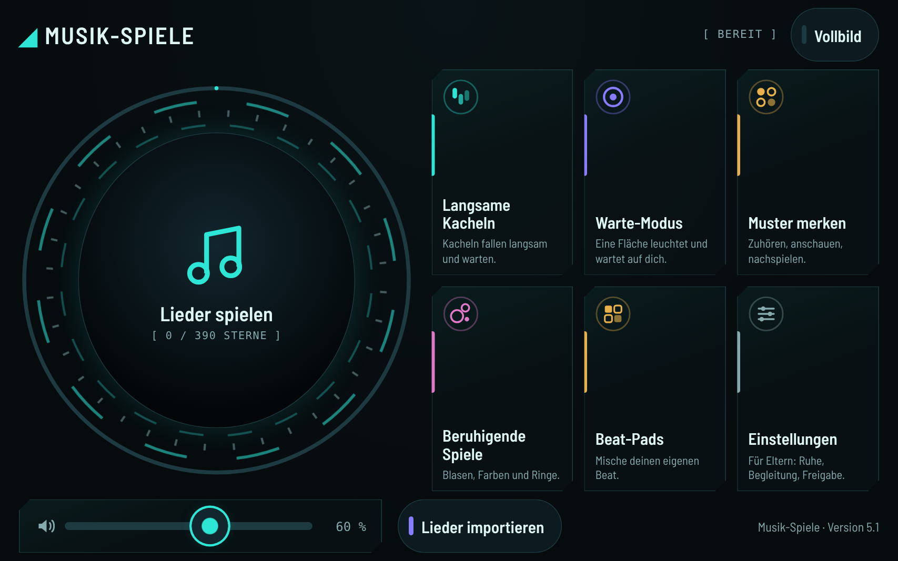
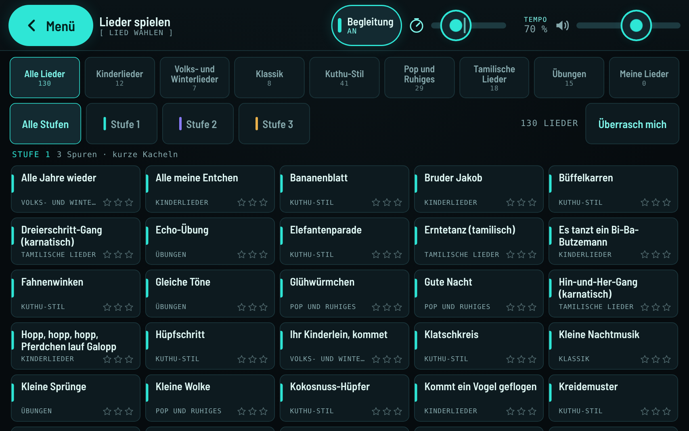
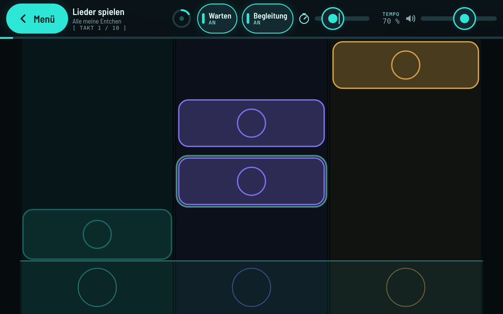
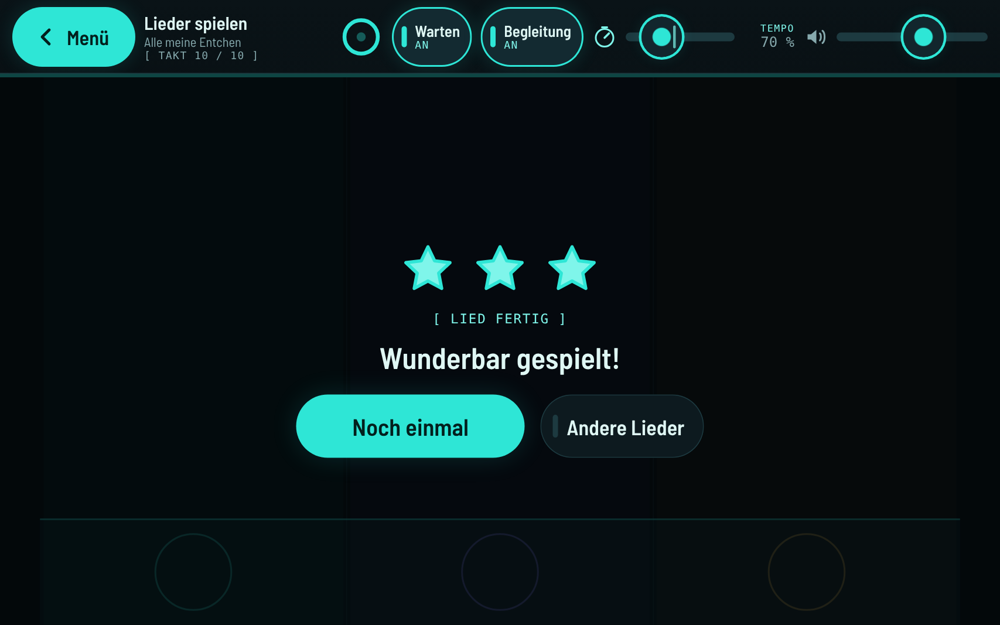
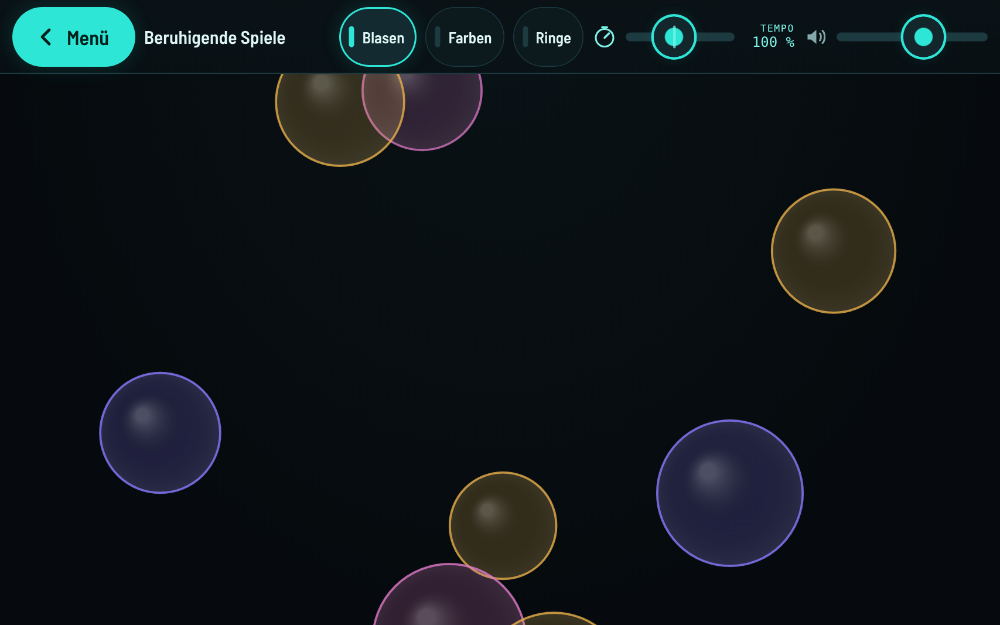
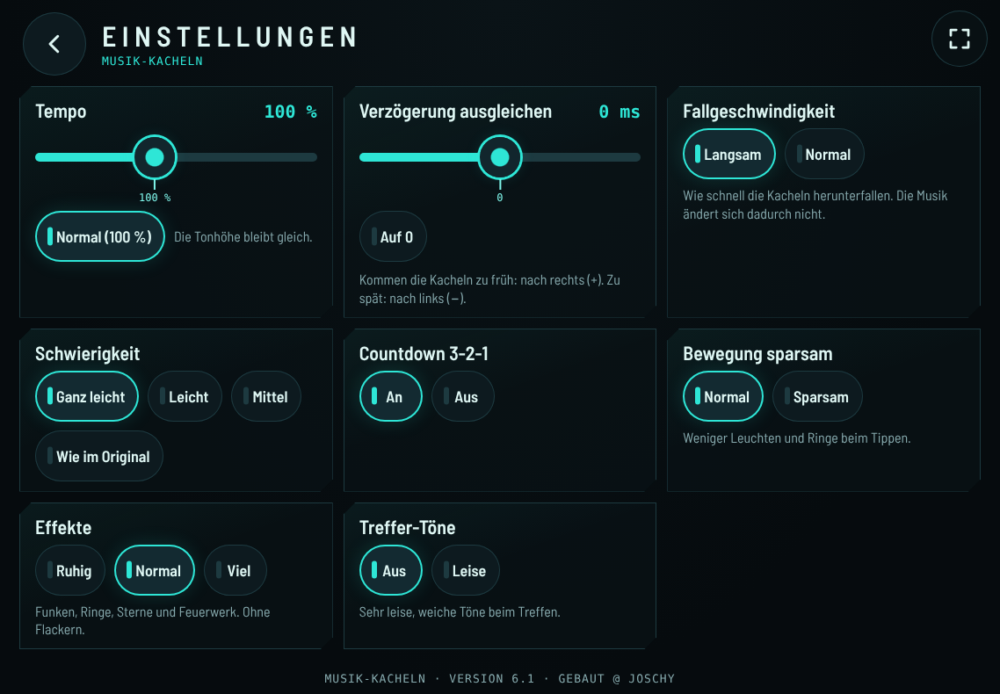

# Krishnas Spiele

## Download

**[APK herunterladen](https://github.com/jr-stack-bot/krishnas-spiele/releases/latest/download/krishnas-spiele.apk)** · [Release-Seite](https://github.com/jr-stack-bot/krishnas-spiele/releases/latest)

Für Android-Tablets und -Handys ab Android 8.

1. Die heruntergeladene APK öffnen.
2. Bei Nachfrage „Installation aus dieser Quelle zulassen“ erlauben.
3. Installieren – fertig.

## Screenshots

Die Bilder stammen aus Version 3 und zeigen die App im Querformat auf einem Tablet.

<table>
  <tr>
    <td width="50%" align="center"> Hauptmenü</td>
    <td width="50%" align="center"> Liederauswahl mit Kategorien</td>
  </tr>
  <tr>
    <td width="50%" align="center"> Lied spielen (Kacheln im Takt, sofort antippbar)</td>
    <td width="50%" align="center"> Ruhiger Belohnungs-Bildschirm</td>
  </tr>
  <tr>
    <td width="50%" align="center"> Beruhigende Spiele</td>
    <td width="50%" align="center"> Einstellungen: Ruhe-Modus und Farbthema</td>
  </tr>
</table>

Ruhige, reizarme Musik- und Tipp-Spiele für Kinder – eine Tablet-Web-App, verpackt als Android-APK.

Die App startet eine lokale `index.html` im Vollbild (Querformat, Display bleibt an, kein Zoom). Läuft ab Android 8 (API 26).

## Spiele

Stand: **Version 5**. Sechs Modi, alle bewusst reizarm gestaltet (ruhige Farben, sanfte Klänge, kein Zeitdruck, keine blinkenden Effekte):

- **Lieder spielen** – 130 Lieder Ton für Ton nachspielen, sortiert in 8 Reitern (7 Kategorien plus „Alle“), in 3 Stufen von ganz leicht bis etwas anspruchsvoller
- **Langsame Kacheln** – Kacheln fallen langsam herunter
- **Warte-Modus** – eine Kachel leuchtet und wartet, bis sie angetippt wird
- **Muster merken** – zuhören, anschauen, nachspielen
- **Beruhigende Spiele** – Blasen und Farben, einfach tippen
- **Beat-Pads** – 8 Stile mit je 12 Loop-Pads zum Antippen und Kombinieren; alle Klänge werden in der App synthetisiert (kein Aufnehmen)

Außerdem:

- **Tempo-Regler** – in jedem Modus von 30 bis 200 % einstellbar
- **Kacheln sofort antippbar** – keine Wartezeit, bevor eine Kachel reagiert
- **Vollbild-Knopf** – blendet die Android-Leisten ein oder aus (Standard beim Start: Vollbild)
- **Ruhe-Modus** – in den Einstellungen (für Eltern) lässt sich die Bewegung im Menü auf „voll“, „sparsam“ oder „aus“ stellen

## Eigene Lieder importieren (MIDI)

Ab Version 5 lassen sich eigene `.mid`-Dateien vom Gerät auswählen. Die App wandelt sie lokal in Kachel-Lieder um und speichert sie nur auf dem Gerät (IndexedDB).

- Es werden keine Dateiinhalte übertragen – die Umwandlung passiert vollständig auf dem Gerät.
- Im Repo und in der App sind keine Songs oder Melodien aus Nutzerdateien enthalten.
- Jeder ist selbst dafür verantwortlich, dass er die Rechte an importierten Dateien hat.
- Hinweis zum Dateidialog: Android zeigt dort alle Dateien an; die App übernimmt aber nur gültige MIDI-Dateien.

## Quellen der Lieder

- **Eigenkompositionen** (ca. 84 Lieder) – eigens für diese App geschrieben.
- **Gemeinfreie Weisen** (ca. 32 Lieder) – traditionelle Melodien, deren Urheberrecht abgelaufen ist. Die Notenvorlagen mehrerer dieser Weisen stammen aus dem [Wikibooks-Liederbuch](https://de.wikibooks.org/wiki/Liederbuch) (Lizenz CC BY-SA 4.0 bzw. wie auf der jeweiligen Seite angegeben).
- Lieder, die als **„im Stil“** gekennzeichnet sind (z. B. tamilische Lieder), sind Eigenkompositionen in Anlehnung an einen Stil – keine Originalweisen.

## APK herunterladen und installieren

1. Auf dem Tablet die Seite **Releases** dieses Repos öffnen (rechts auf der Repo-Startseite oder `…/releases/latest`).
2. Die Datei **`krishnas-spiele.apk`** herunterladen.
3. Die heruntergeladene Datei antippen. Android fragt beim ersten Mal, ob der Browser/Dateimanager **unbekannte Apps installieren** darf → in den Einstellungen erlauben (*Einstellungen → Apps → [Browser] → Unbekannte Apps installieren*).
4. Installieren – fertig. Neue Versionen lassen sich einfach drüberinstallieren.

## Aufbau

- `app/src/main/assets/index.html` – die Web-App mit allen Spielen
- `app/src/main/assets/OFL-Barlow.txt` – Lizenztext der eingebetteten Schrift
- `app/src/main/java/.../MainActivity.java` – Vollbild-WebView mit JS-Brücke `AndroidHuelle` (Vollbild an/aus), System-Dateiauswahl für `<input type="file">` und dunklem Hintergrund ohne weißen Startblitz
- `app/src/main/res/` – adaptives App-Icon (Hintergrund, Vordergrund, Monochrom) und dunkles Theme
- `.github/workflows/build-apk.yml` – baut bei jedem Push auf `main` die Debug-APK und veröffentlicht sie als Release `latest`

Lokal bauen: `gradle assembleDebug` (Gradle 8.x, JDK 17, Android SDK).

Hinweis: `app/debug.keystore` ist ein gewöhnlicher Android-Debug-Schlüssel mit Standardpasswörtern, damit Updates dieselbe Signatur haben. Er ist kein Geheimnis.

## Schrift

Die App bettet die Schrift **Barlow Semi Condensed** ein (© The Barlow Project Authors), lizenziert unter der **SIL Open Font License 1.1**. Der Lizenztext liegt in `app/src/main/assets/OFL-Barlow.txt` und wird mit der APK ausgeliefert.

---

@ Joschy · Lizenz: MIT (siehe `LICENSE`), ausgenommen die eingebettete Schrift (OFL 1.1)
