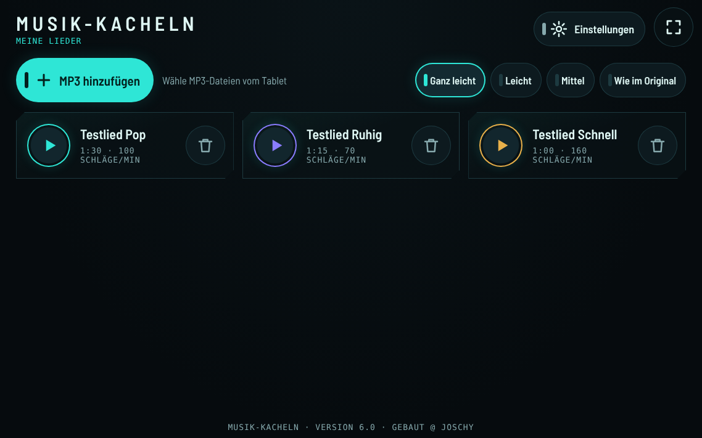
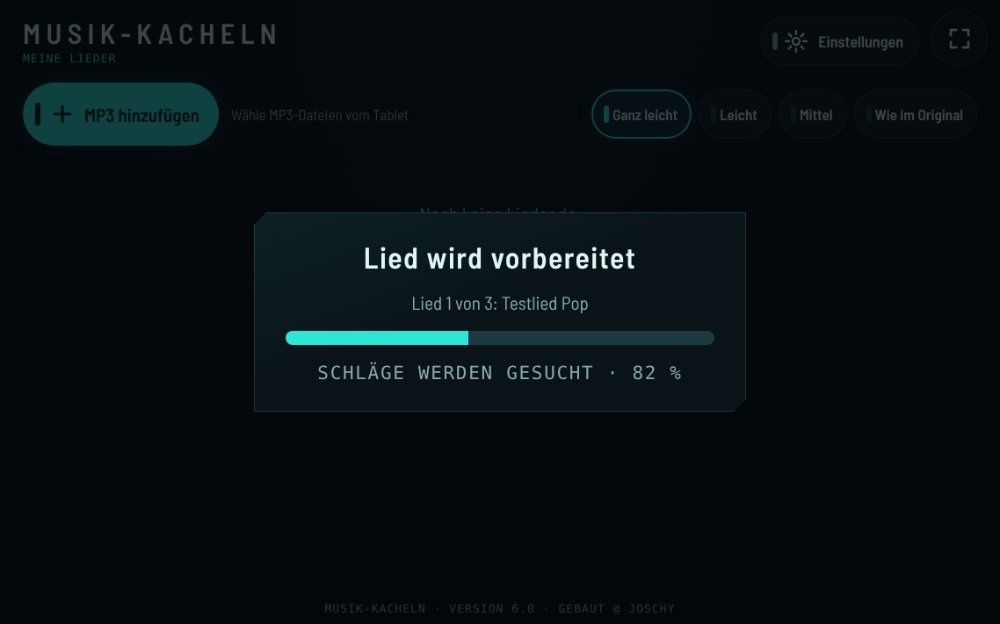
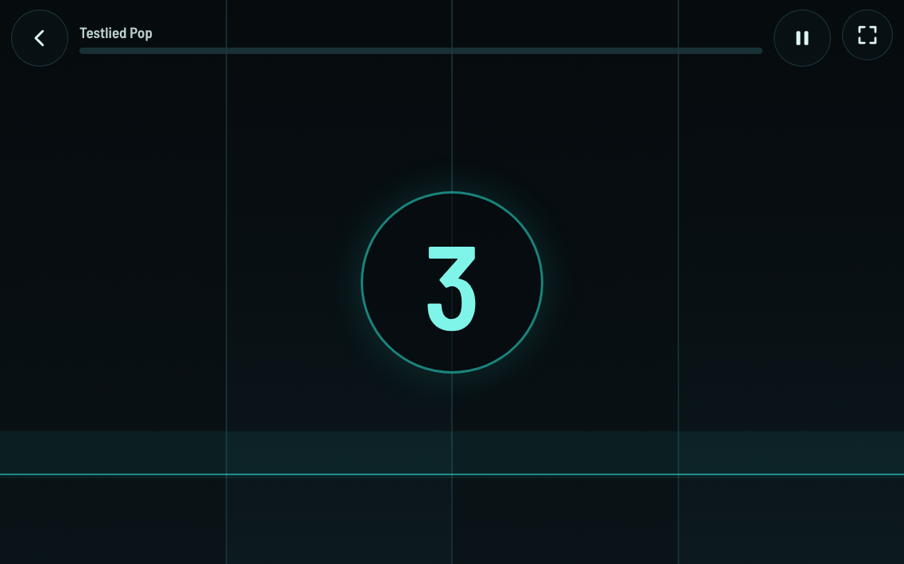
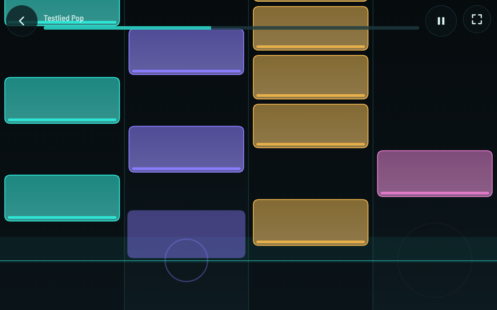
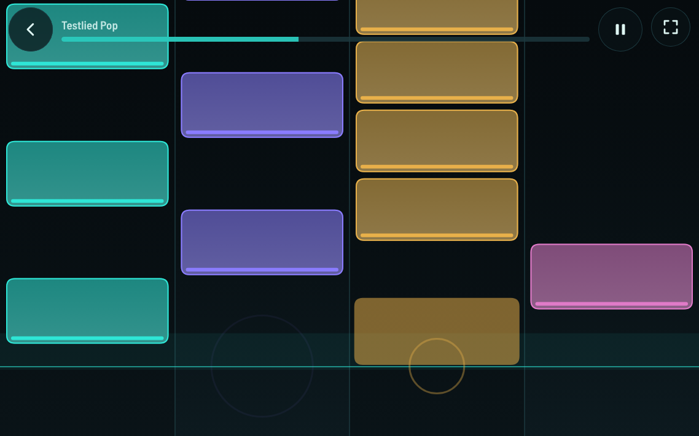
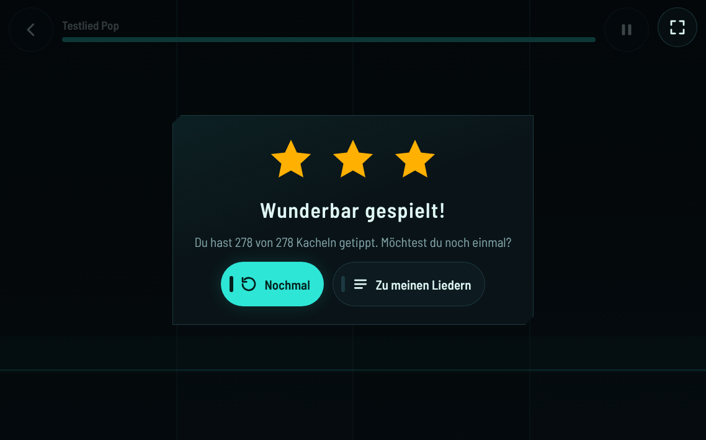
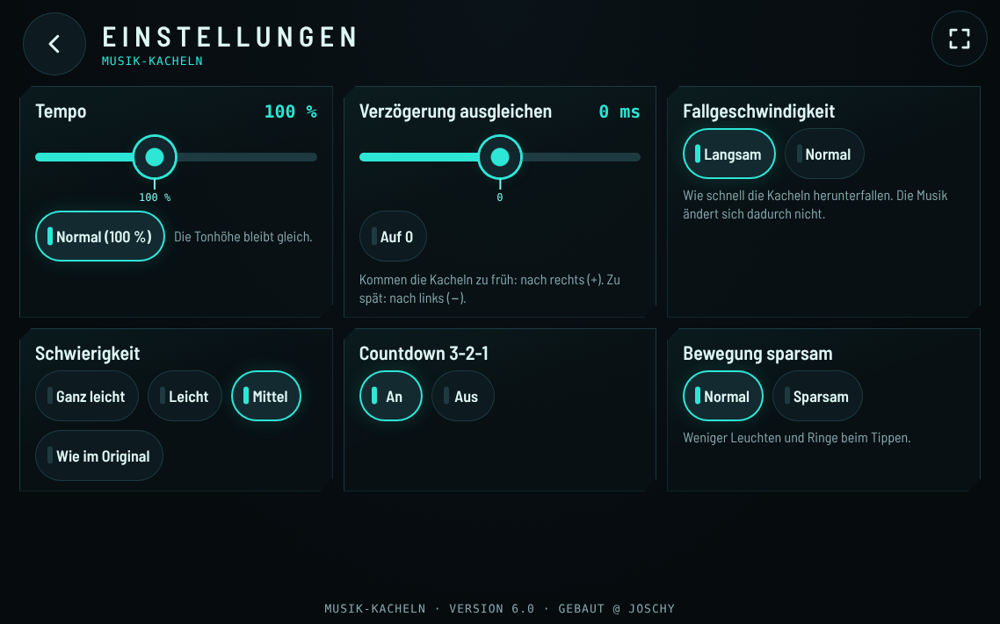

# Krishnas Spiele – Musik-Kacheln

## Download

**[APK herunterladen](https://github.com/jr-stack-bot/krishnas-spiele/releases/latest/download/krishnas-spiele.apk)** · [Release-Seite](https://github.com/jr-stack-bot/krishnas-spiele/releases/latest)

Für Android-Tablets und -Handys ab Android 8.

1. Die heruntergeladene APK öffnen.
2. Bei Nachfrage „Installation aus dieser Quelle zulassen“ erlauben.
3. Installieren – fertig. Neue Versionen lassen sich einfach drüberinstallieren.

## Was ist das?

**Musik-Kacheln** (Version 6.0) ist ein ruhiges Tipp-Spiel für das Tablet: Du wählst eigene MP3-Dateien aus, die App hört sich die Musik an und macht daraus Kacheln. Die Kacheln fallen im Takt der Musik herunter. Tippe sie an, wenn sie die Linie erreichen.

Auf dem Tablet heißt die App weiterhin **„Krishnas Spiele“**.

## Screenshots

Die Bilder zeigen die App im Querformat (1138 × 711). Die Lieder darauf sind selbst erzeugte Test-Töne, keine echte Musik.

<table>
  <tr>
    <td width="50%" align="center"> Startseite: eigene Lieder und Schwierigkeit</td>
    <td width="50%" align="center"> Ein Lied wird vorbereitet</td>
  </tr>
  <tr>
    <td width="50%" align="center"> Start mit Countdown 3-2-1</td>
    <td width="50%" align="center"> Mitten im Lied: Kacheln auf vier Spuren</td>
  </tr>
  <tr>
    <td width="50%" align="center"> Treffer: ein Ring an der Linie</td>
    <td width="50%" align="center"> Ergebnis mit Sternen</td>
  </tr>
  <tr>
    <td width="50%" align="center"> Einstellungen</td>
    <td width="50%"></td>
  </tr>
</table>

## Kurzanleitung

1. **MP3 aufs Tablet kopieren** – zum Beispiel per USB-Kabel in den Ordner „Download“ oder „Music“.
2. In der App **„MP3 hinzufügen“** antippen und eine oder mehrere Dateien auswählen. Die App bereitet jedes Lied einmal vor (das dauert ein paar Sekunden). Danach steht es in der Liste.
3. Oben die **Schwierigkeit** wählen: „Ganz leicht“, „Leicht“, „Mittel“ oder „Wie im Original“.
4. Wer mag, stellt in den **Einstellungen** das **Tempo** ein (langsamer oder schneller, die Tonhöhe bleibt gleich).
5. Beim Lied auf **Abspielen** tippen, Countdown abwarten, Kacheln an der Linie antippen.

Ein Lied löschen: auf den Mülleimer tippen und noch einmal bestätigen.

## Grenzen

- **MP3** bis **20 Minuten** Länge.
- **Andere Formate** (z. B. M4A, OGG, WAV) bis **8 Minuten**.
- Stille oder beschädigte Dateien werden mit einer freundlichen Meldung abgelehnt.
- Der Dateidialog von Android zeigt alle Dateien an; die App übernimmt nur Musikdateien, die sie lesen kann.

## Datenschutz

- Die Musik wird **nur auf dem Gerät** verarbeitet. **Nichts wird hochgeladen**, die App braucht kein Internet.
- Die vorbereiteten Lieder werden nur auf dem Gerät gespeichert (im Speicher der App).
- Im App-Paket und in diesem Repo ist **keine Musik** enthalten.
- Jeder ist selbst dafür verantwortlich, dass er die Rechte an den eigenen Dateien hat.

## Wie entstehen die Kacheln?

Die App hört sich das Lied einmal ganz an und sucht darin:

- **Den Takt** – wie viele Schläge pro Minute das Lied hat und wo die Schläge liegen.
- **Einsätze** – Stellen, an denen ein Ton oder ein Schlag neu beginnt.
- **Die Klangfarbe** – ob ein Einsatz eher tief (z. B. Bass-Trommel) oder eher hell (z. B. Becken) klingt. Danach kommt die Kachel auf eine der vier Spuren.
- **Lange Töne** – daraus werden längere Kacheln zum Halten (ab „Leicht“).

Die Schwierigkeit bestimmt, wie viele der gefundenen Einsätze zu Kacheln werden. „Ganz leicht“ nimmt nur die wichtigsten Schläge, „Wie im Original“ fast alles.

**Was nicht perfekt ist:**

- Die App kennt keine Noten. Die Spuren richten sich nach der Klangfarbe, nicht nach Melodie oder Instrument.
- Bei sehr ruhigen Liedern, Liedern ohne Schlagzeug, viel Hall oder wechselndem Tempo liegen die Kacheln manchmal etwas daneben oder es gibt weniger Kacheln.
- Mit Bluetooth-Kopfhörern kann der Ton etwas später ankommen. Dafür gibt es in den Einstellungen „Verzögerung ausgleichen“.

## Frühere Version

`archive/index.v5.1.html` ist die frühere Version 5.1 mit Synthesizer-Spielen (Lieder spielen, Beat-Pads und ruhige Spiele). Sie ist nur zum Nachschauen im Repo und nicht mehr in der APK. Die Notenvorlagen einiger gemeinfreier Weisen darin stammen aus dem [Wikibooks-Liederbuch](https://de.wikibooks.org/wiki/Liederbuch) (CC BY-SA 4.0 bzw. wie auf der jeweiligen Seite angegeben).

## Aufbau

- `app/src/main/assets/index.html` – die Web-App Musik-Kacheln
- `app/src/main/assets/OFL-Barlow.txt` – Lizenztext der eingebetteten Schrift
- `app/src/main/java/.../MainActivity.java` – Vollbild-WebView mit JS-Brücke `AndroidHuelle` (Vollbild an/aus), System-Dateiauswahl für `<input type="file">`, Display bleibt an, Spiel pausiert beim Verlassen der App, und nach einem Absturz der WebView wird sie neu geladen statt die App zu beenden
- `app/src/main/res/` – adaptives App-Icon (Hintergrund, Vordergrund, Monochrom) und dunkles Theme
- `archive/` – frühere Version (nicht in der APK)
- `.github/workflows/build-apk.yml` – baut bei jedem Push auf `main` die Debug-APK und veröffentlicht sie als Release `latest`

Lokal bauen: `gradle assembleDebug` (Gradle 8.x, JDK 17, Android SDK).

Hinweis: `app/debug.keystore` ist ein gewöhnlicher Android-Debug-Schlüssel mit Standardpasswörtern, damit Updates dieselbe Signatur haben. Er ist kein Geheimnis.

## Schrift

Die App bettet die Schrift **Barlow Semi Condensed** ein (© The Barlow Project Authors), lizenziert unter der **SIL Open Font License 1.1**. Der Lizenztext liegt in `app/src/main/assets/OFL-Barlow.txt` und wird mit der APK ausgeliefert.

---

@ Joschy · Lizenz: MIT (siehe `LICENSE`), ausgenommen die eingebettete Schrift (OFL 1.1)
